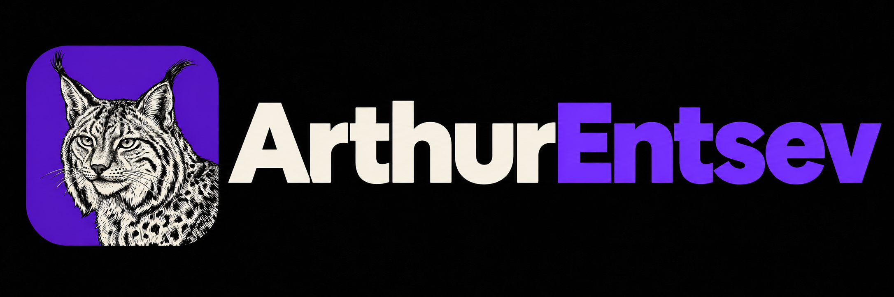

<strong>Back-end, automação e ferramentas que resolvem problemas reais.</strong>

<a href="#sobre-mim">Sobre</a> · <a href="#produtos-em-destaque">Produtos</a> · <a href="#engenharia-e-aplicações">Engenharia</a> · <a href="#tecnologias">Tecnologias</a> · <a href="#explore-a-coleção">Repositórios</a>

Sou **Arthur Mendes Entsev**, desenvolvedor back-end na **Flash Engenharia** e estudante de **Análise e Desenvolvimento de Sistemas na Fatec Sorocaba**.

Trabalho com automações, configuradores técnicos e ferramentas internas para engenharia. Nos meus projetos, exploro APIs, aplicações desktop, interfaces web e processamento local de arquivos.

<table>
<tr><th align="left">No trabalho</th><th align="left">Nos meus projetos</th></tr>
<tr><td>Back-end, automação de tarefas e ferramentas para engenharia.</td><td>Aplicações locais, integração entre plataformas e interfaces que tornam tarefas técnicas mais acessíveis.</td></tr>
<tr><td>Transformar necessidades práticas em soluções que possam ser usadas no dia a dia.</td><td>Documentar o funcionamento, organizar o código e aprender construindo.</td></tr>
</table>

Ferramentas com identidade própria, documentação e um problema concreto para resolver.

<table>
<tr>
<td width="50%" valign="top"><h3>LynowCut</h3>
Compressão local de imagens, PDFs, documentos, vídeos e áudio, com meta de tamanho.

Python · PySide6 · Pillow · FFmpeg
<a href="https://github.com/arthurlynow098/LynowCut"><strong>Explorar projeto →</strong></a>  </td><td width="50%" valign="top"><h3>LynowMic</h3>
O celular Android como fonte de áudio para o Windows pela rede local, com pareamento por QR Code.

C# · WPF · Kotlin · TLS
<a href="https://github.com/arthurlynow098/LynowMic"><strong>Explorar projeto →</strong></a>  </td></tr><tr><td width="50%" valign="top"><h3>LynowCatch</h3>
Uma central local para baixar e converter links em vídeo, áudio e GIF, com fila e recorte.

Python · yt-dlp · FFmpeg · JavaScript
<a href="https://github.com/arthurlynow098/LynowCatch"><strong>Explorar projeto →</strong></a>  </td><td width="50%" valign="top"><h3>Verificador de Cópias</h3>
Busca imagens duplicadas por hash ou semelhança visual e organiza as cópias em uma pasta.

Python · Tkinter · Pillow · ImageHash
<a href="https://github.com/arthurlynow098/Verificador-de-Copias"><strong>Explorar projeto →</strong></a>  </td></tr></table>

<table><tr><td width="50%" valign="top"><h3>Product Manager</h3>
API REST e painel web para estudar gestão de produtos, herança e polimorfismo.

Java · Spring Boot · Maven
<a href="https://github.com/arthurlynow098/spring-boot-product-manager"><strong>Explorar projeto →</strong></a>  </td><td width="50%" valign="top"><h3>Lynow Corp</h3>
Back-end e modelagem de dados para conectar clientes e profissionais.

Java · Spring Data JPA · MySQL
<a href="https://github.com/arthurlynow098/lynow-corp-platform"><strong>Explorar projeto →</strong></a>  </td></tr><tr><td width="50%" valign="top"><h3>Docker Configurator</h3>
Aplicação web e banco de dados organizados em um ambiente de containers.

Docker · PHP · MySQL
<a href="https://github.com/arthurlynow098/Docker-product-configurator"><strong>Explorar projeto →</strong></a>  </td><td width="50%" valign="top"><h3>F1 Financial Controller</h3>
Estudo de engenharia de prompts aplicado a orçamento, cenários e riscos de uma equipe de F1.

Prompts · LLMs · Análise de cenários
<a href="https://github.com/arthurlynow098/f1-strategic-financial-controller"><strong>Explorar projeto →</strong></a>  </td></tr></table>

### Projeto integrador · O-BRECHÓ

**[ANG / O-BRECHÓ](https://github.com/arthurlynow098/ANG)** — sistema de gestão para a Associação Nova Geração, desenvolvido em equipe no Projeto Integrador. Reúne doações, estoque, vendas e caixa, com documentação de requisitos, protótipos e testes.

 

| Área | Ferramentas presentes nos meus projetos |
|---|---|
| **Back-end e APIs** | Java · Spring Boot · C# · ASP.NET Core · PHP · Node.js · Express |
| **Desktop e automação** | Python · PySide6 · Tkinter · Pillow · WPF · Windows Forms · VBA |
| **Dados** | MySQL · SQL Server · Oracle PL/SQL · Entity Framework · Spring Data JPA |
| **Interfaces** | JavaScript · TypeScript · React · HTML · CSS · Bootstrap · Razor |
| **Infraestrutura e colaboração** | Docker · Git · GitHub Actions · Maven |

### Web, APIs e gestão

| Projeto | O que você encontra |
|---|---|
| [Carrinho de Compras](https://github.com/arthurlynow098/Carrinho-de-Compras) | Listas por categoria, usuários e relatórios em PDF. |
| [Projeto Enquete](https://github.com/arthurlynow098/ProjetoPWEnquete) | Enquetes, autenticação, perfis de acesso e persistência em SQL Server. |
| [Ping Enquetes](https://github.com/arthurlynow098/Ping-Enquetes) | Criação e votação em enquetes com persistência em JSON. |
| [MVC-PW](https://github.com/arthurlynow098/MVC-PW) | Estudos de MVC com veículos, dispositivos móveis e eventos. |
| [CRUD de Clientes](https://github.com/arthurlynow098/crud-bootstrap-php-main2.0) | Cadastro, consulta, edição e exclusão com PHP e Bootstrap. |
| [Planilha Pessoal](https://github.com/arthurlynow098/Planilha-Pessoal) | Organização financeira e pessoal com gráficos e temas. |

### Desktop, mobile e jogos

| Projeto | O que você encontra |
|---|---|
| [Gestão de Voos](https://github.com/arthurlynow098/Sistema-Gerenciar-V-os) | Gerenciamento de aeronaves e pilotos em Windows Forms. |
| [Aula APS](https://github.com/arthurlynow098/AulaAps) | Formas geométricas, abstração, herança e polimorfismo. |
| [Maui App](https://github.com/arthurlynow098/MauiAPP) | Interface compartilhada e projetos para Android e Windows. |
| [Flappy Bird](https://github.com/arthurlynow098/FlappyBird-Game) | Jogo de navegador com JavaScript, HTML e CSS. |
| [JavaFut](https://github.com/arthurlynow098/JavaFut) | Projeto de estudo em Java com domínio de futebol. |

### Dados, infraestrutura e segurança

| Projeto | O que você encontra |
|---|---|
| [SQL Engineering Lab](https://github.com/arthurlynow098/SQL-engineering-lab) | Modelagem, consultas, filtros e indicadores. |
| [PL/SQL Training](https://github.com/arthurlynow098/PL-SQL-Training) | Blocos, variáveis e constantes em Oracle PL/SQL. |
| [SQL Studies](https://github.com/arthurlynow098/sql-studies) | Seleção, operadores, condições e criação de bases. |
| [Versionamento Git](https://github.com/arthurlynow098/Pesquisa-versionamento-Git) | Commits, branches e fluxo local de versionamento. |
| [GitHub Actions](https://github.com/arthurlynow098/forage-github-task) | Exercício de workflow e integração contínua. |
| [Phishing Defense](https://github.com/arthurlynow098/Cybersecurity-phishing-defense) | Laboratório acadêmico de engenharia social e análise de phishing. |

### Aprendizado e trajetória

- **Programação web:** [TAPWM](https://github.com/arthurlynow098/TAPWM) · [PWBE](https://github.com/arthurlynow098/PWBE)
- **Fundamentos:** [Algoritmos e Lógica](https://github.com/arthurlynow098/Algoritmos-e-Logica-de-Programacao) · [Java Diferença](https://github.com/arthurlynow098/JavaDiferenca) · [Soma de Inteiros](https://github.com/arthurlynow098/SomaInt)
- **Apresentação e formação:** [Portfólio](https://github.com/arthurlynow098/portfolio) · [P-Tech](https://github.com/arthurlynow098/Ptech) · [Front-end TCC](https://github.com/arthurlynow098/frontEndTCC)

O **lince** acompanha a identidade deste perfil. A coleção visual dos projetos usa gravuras de animais e tem como referência as apresentações de **LynowCut, LynowMic e LynowCatch**. Cada projeto mantém sua documentação e seus créditos.

<a href="assets/identity-v2/logo.png">Logo em PNG</a> · <a href="assets/identity-v2/banner.png">Banner em PNG</a>

<strong>Estudo · construção · evolução</strong>

<a href="https://arthurentsev.vercel.app/">Portfólio</a> · <a href="https://www.linkedin.com/in/entsevarthur/">LinkedIn</a> · <a href="mailto:arthurmendes0505@Outlook.com">E-mail</a> · <a href="#top">Voltar ao topo ↑</a>

