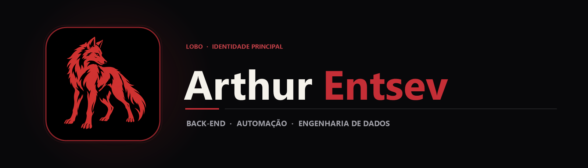

  

  Desenvolvedor Back-End com foco em APIs REST, automação aplicada à engenharia, bancos de dados relacionais e arquitetura limpa.

  
  
  

## Sobre mim

Sou **Arthur Mendes Entsev**, desenvolvedor back-end com atuação prática na criação de automações, configuradores técnicos e ferramentas internas para o setor de engenharia. Na **Flash Engenharia**, transformo demandas reais de operação e produto em sistemas confiáveis, reduzindo trabalho manual e padronizando regras de negócio.

Na graduação em **Análise e Desenvolvimento de Sistemas (Fatec Sorocaba)**, aprofundo a construção de aplicações em camadas, APIs RESTful com Java e Spring Boot, sistemas desktop e web com C#/.NET, utilitários em Python, modelagem SQL e ambientes reprodutíveis com Docker.

## Tecnologias e instrumentos

  
  
  
  
  
  
  
  
  
  
  

| Domínio | Tecnologias e práticas |
|---|---|
| **Back-end e APIs** | Java · Spring Boot · C# · ASP.NET Core MVC · PHP · Node.js · Express |
| **Desktop e Automação** | Python (PySide6, Tkinter, Pillow) · WPF (.NET) · Windows Forms · VBA / Excel |
| **Bancos de Dados** | MySQL · SQL Server · Oracle PL/SQL · Entity Framework Core · Spring Data JPA |
| **Infraestrutura e DevOps** | Docker · Docker Compose · Git · GitHub Actions · Linux / CLI |
| **Front-end e Interfaces** | JavaScript · TypeScript · React · HTML5 · CSS3 · Bootstrap · Razor |

## Projetos em destaque

| Projeto | Símbolo | Stack | O que entrega |
|---|---|---|---|
| **[LynowMic](https://github.com/arthurlynow098/LynowMic)** | Morcego | C# · WPF · Kotlin · TLS 1.2 | Transforma o celular Android em microfone sem fio para o Windows via rede local com pareamento QR Code e baixa latência. |
| **[LynowCut](https://github.com/arthurlynow098/LynowCut)** | Louva-a-deus | Python · PySide6 · FFmpeg | Compressor local de imagens, PDFs, documentos, vídeos e áudio com meta exata em bytes ou porcentagem. |
| **[O-BRECHÓ · ANG](https://github.com/arthurlynow098/ANG)** | Andorinha | TypeScript · React · SQL | Sistema de gestão solidária para controle de doações, triagem, estoque, vendas e fluxo de caixa. |
| **[Product Manager](https://github.com/arthurlynow098/spring-boot-product-manager)** | Bisão | Java 17 · Spring Boot · JS | API RESTful e dashboard integrado para gestão de inventário aplicando herança e polimorfismo em POO. |
| **[Lynow Corp Platform](https://github.com/arthurlynow098/lynow-corp-platform)** | Elefante | Java 17 · Spring Data JPA · MySQL | Plataforma back-end e modelagem relacional para conexão entre clientes e profissionais em micro-jobs. |
| **[Docker Configurator](https://github.com/arthurlynow098/Docker-product-configurator)** | Baleia | Docker · PHP 8.2 · MySQL 8.0 | Infraestrutura multi-container isolada com Dockerfile customizado, volumes persistentes e rede bridge. |
| **[F1 Financial Controller](https://github.com/arthurlynow098/f1-strategic-financial-controller)** | Guepardo | Prompt Engineering · LLMs | Controladoria estratégica e orçamento de equipe de Fórmula 1 para o regulamento de 2026 com CoT, ToT e CAE. |
| **[Verificador de Cópias](https://github.com/arthurlynow098/Verificador-de-Copias)** | Guaxinim | Python · Tkinter · ImageHash | Ferramenta desktop que detecta e isola fotos duplicadas por hash criptográfico ou similaridade perceptual. |

## Mapa completo de repositórios

`mermaid
flowchart LR
    A[Arthur Entsev] --> B[Produtos Desktop e Mobile]
    A --> C[APIs, Web e Sistemas MVC]
    A --> D[Engenharia de Dados e Infra]
    A --> E[Segurança, IA e Fundamentos]
    B --> B1[LynowMic · LynowCut · Verificador de Cópias · MauiAPP]
    C --> C1[ANG · Product Manager · LynowCorp · BuyCart · Enquetes]
    D --> D1[Docker Configurator · SQL Lab · PL/SQL · SQL Studies]
    E --> E1[F1 Controller · Phishing Defense · Algoritmos · Java]
`

### Aplicações Web, APIs e Sistemas MVC
- **[Carrinho-de-Compras](https://github.com/arthurlynow098/Carrinho-de-Compras)** — E-commerce e lista de compras com ASP.NET Core MVC, Entity Framework Core, SQL Server e exportação em PDF.
- **[ProjetoPWEnquete](https://github.com/arthurlynow098/ProjetoPWEnquete)** — Plataforma completa de enquetes com autenticação ASP.NET Core Identity, painel administrativo e SQL Server.
- **[Ping-Enquetes](https://github.com/arthurlynow098/Ping-Enquetes)** — Aplicação web ágil de votações em tempo real construída em ASP.NET Core (.NET 9) com persistência JSON e sessões.
- **[MVC-PW](https://github.com/arthurlynow098/MVC-PW)** — Sistema multi-domínio em ASP.NET Core MVC com CRUD de veículos, dispositivos móveis e eventos.
- **[crud-bootstrap-php-main2.0](https://github.com/arthurlynow098/crud-bootstrap-php-main2.0)** — Sistema de gestão de clientes em PHP e MySQL com interface responsiva em Bootstrap e Font Awesome.
- **[Planilha-Pessoal](https://github.com/arthurlynow098/Planilha-Pessoal)** — Aplicação web modular para controle financeiro pessoal, visualização de gráficos e temas customizáveis.
- **[TAPWM](https://github.com/arthurlynow098/TAPWM)** — Coleção progressiva de projetos de programação web, cobrindo DOM, Promises, Callbacks, Node.js, Express e EJS.
- **[PWBE](https://github.com/arthurlynow098/PWBE)** — Estudo de arquitetura back-end e execução assíncrona no ecossistema Node.js.

### Aplicações Desktop, Mobile e Jogos
- **[Sistema-Gerenciar-V-os](https://github.com/arthurlynow098/Sistema-Gerenciar-V-os)** — Sistema desktop em C# Windows Forms com SQL Server e DataSet tipado para gestão de aeronaves e pilotos.
- **[AulaAps](https://github.com/arthurlynow098/AulaAps)** — Calculadora geométrica desktop em C# Windows Forms aplicando abstração, herança e polimorfismo.
- **[MauiAPP](https://github.com/arthurlynow098/MauiAPP)** — Aplicação multiplataforma em C# e .NET MAUI (.NET 9) com targets nativos para Android e Windows (WinUI).
- **[FlappyBird-Game](https://github.com/arthurlynow098/FlappyBird-Game)** — Recriação do clássico arcade Flappy Bird para navegador utilizando JavaScript puro, HTML5 e CSS3.
- **[LynowCatch](https://github.com/arthurlynow098/LynowCatch)** — Pacote de automação e captura de mídia com distribuição compactada do código-fonte.

### Dados, Infraestrutura, Segurança e IA
- **[SQL-engineering-lab](https://github.com/arthurlynow098/SQL-engineering-lab)** — Laboratório de engenharia de dados em MySQL cobrindo DDL, DQL, filtros booleanos e sinalizadores de negócio.
- **[PL-SQL-Training](https://github.com/arthurlynow098/PL-SQL-Training)** — Treinamento em programação procedural Oracle PL/SQL com blocos anônimos, variáveis e constantes.
- **[sql-studies](https://github.com/arthurlynow098/sql-studies)** — Caderno prático de consultas SQL, operadores lógicos, filtros de intervalo e criação de schemas.
- **[Cybersecurity-phishing-defense](https://github.com/arthurlynow098/Cybersecurity-phishing-defense)** — Laboratório acadêmico de cibersegurança voltado à análise de vetores de engenharia social e defesa contra phishing.
- **[Pesquisa-versionamento-Git](https://github.com/arthurlynow098/Pesquisa-versionamento-Git)** — Guia técnico e projeto demonstrativo sobre fluxo de versionamento local, ramificações e linha de comando Git.
- **[forage-github-task](https://github.com/arthurlynow098/forage-github-task)** — Automação de pipelines e integração contínua com GitHub Actions.

### Portfólios e Fundamentos de Computação
- **[portfolio](https://github.com/arthurlynow098/portfolio)** · **[Ptech](https://github.com/arthurlynow098/Ptech)** · **[frontEndTCC](https://github.com/arthurlynow098/frontEndTCC)** · **[Algoritmos-e-Logica-de-Programacao](https://github.com/arthurlynow098/Algoritmos-e-Logica-de-Programacao)** · **[JavaDiferenca](https://github.com/arthurlynow098/JavaDiferenca)** · **[SomaInt](https://github.com/arthurlynow098/SomaInt)** · **[JavaFut](https://github.com/arthurlynow098/JavaFut)**

---

Estudo · construção · evolução <a href="https://github.com/arthurlynow098">Perfil</a> · <a href="https://arthurentsev.vercel.app/">Portfólio</a> · <a href="https://www.linkedin.com/in/entsevarthur/">LinkedIn</a>

