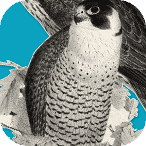
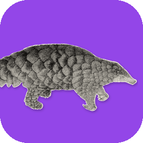
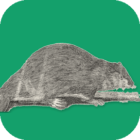
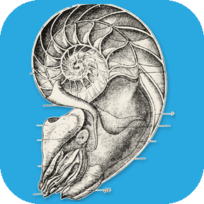

Arthur Entsev

---

  

  Dev back-end na Flash Engenharia, estudante de ADS na Fatec Sorocaba e cada vez mais dentro da cibersegurança.

  
  
  
  

## Lince Lab

Cibersegurança na prática, do scanner de portas ao mini IDS

<table>
<tr><td align="center" width="14%"> Portscan</td><td align="center" width="14%"> Password Auditor</td><td align="center" width="14%"> Hash Lab</td><td align="center" width="14%"> SSH Brute Detector</td><td align="center" width="14%"> FIM PowerShell</td><td align="center" width="14%"> Phishing Analyzer</td><td align="center" width="14%"> Headers Scanner</td></tr>
<tr><td align="center" width="14%"> Network Sentinel</td><td align="center" width="14%"> Cofre de Senhas</td><td align="center" width="14%"> JWT Inspector</td><td align="center" width="14%"> Subdomain Recon</td><td align="center" width="14%"> Cifras Clássicas</td><td align="center" width="14%"> Secure Flask Lab</td></tr>
</table>

## Lynow

Programas que eu uso no dia a dia e publico para quem precisar

<table>
<tr><td align="center" width="14%"> LynowCut</td><td align="center" width="14%"> LynowMic</td><td align="center" width="14%"> LynowCatch</td><td align="center" width="14%"> LynowBOM</td><td align="center" width="14%"> LynowWatch</td><td align="center" width="14%"> LynowWorlds</td></tr>
</table>

## Back-end e estudos

APIs, redes, bancos de dados e as matérias da Fatec

<table>
<tr><td align="center" width="14%"> Taskflow API</td><td align="center" width="14%"> Subnet Calc</td><td align="center" width="14%"> Pulso Uptime</td><td align="center" width="14%"> Product Manager</td><td align="center" width="14%"> Lynow Corp</td><td align="center" width="14%"> Docker Config</td></tr>
<tr><td align="center" width="14%"> Projeto Enquete</td><td align="center" width="14%"> SQL Engineering</td><td align="center" width="14%"> TAPWM</td><td align="center" width="14%"> Front-end TCC</td><td align="center" width="14%"> Portfólio</td><td align="center" width="14%"> Flappy Bird</td></tr>
</table>

## Tecnologias

  
  
  
  
  
  
  
  
  
  

## Agora estudando

- Trilha de SOC no TryHackMe e os laboratórios da PortSwigger Academy
- Homelab com Wazuh para detectar os ataques que os projetos do Lince Lab simulam
- Regras de detecção em Sigma e YARA

As gravuras do Lince Lab e dos projetos de back-end são ilustrações antigas em domínio público, com o crédito no README de cada projeto.

