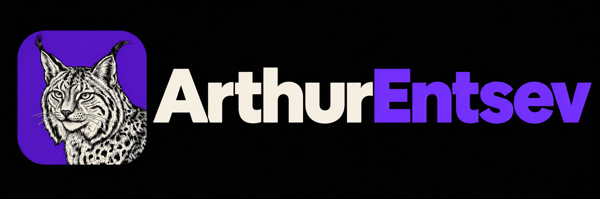
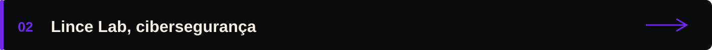
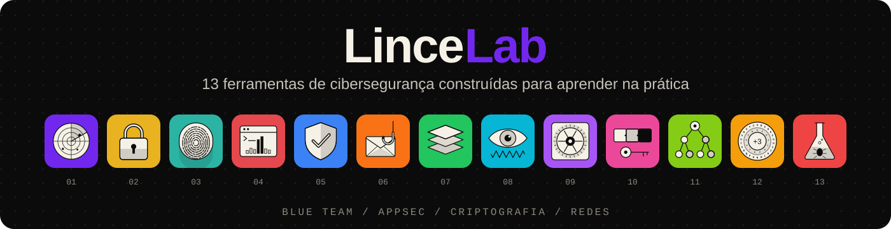
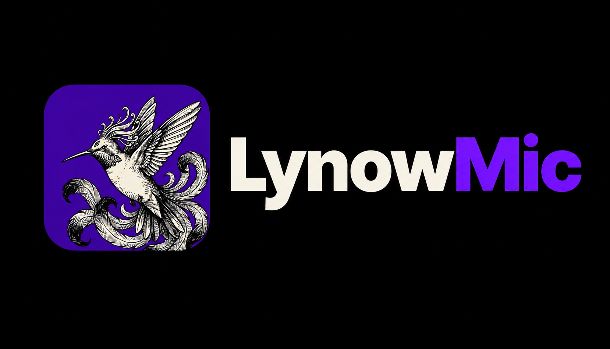
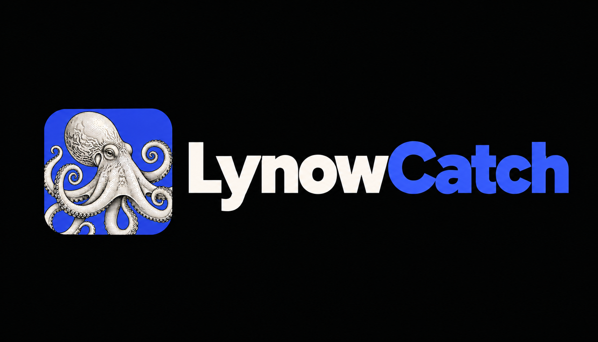
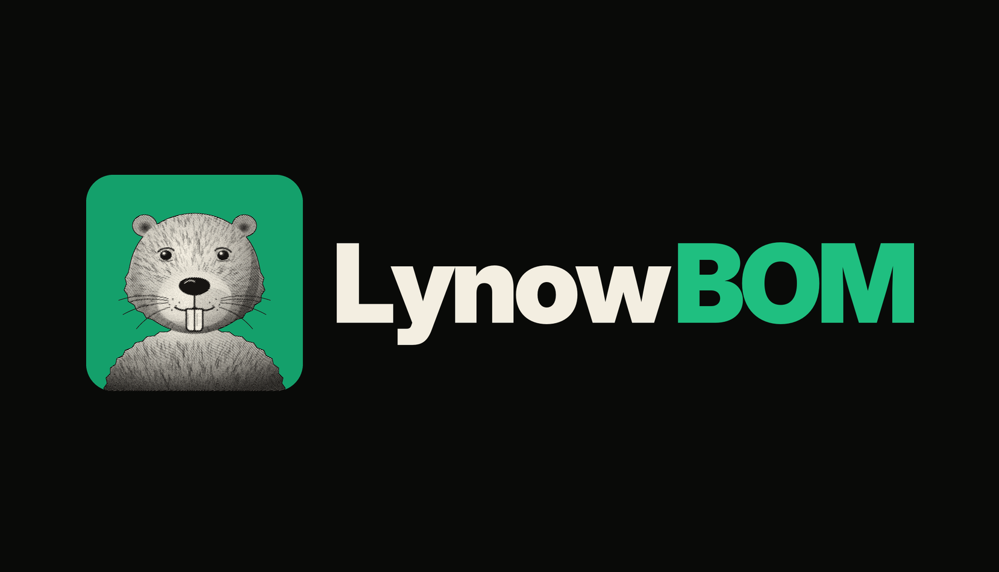
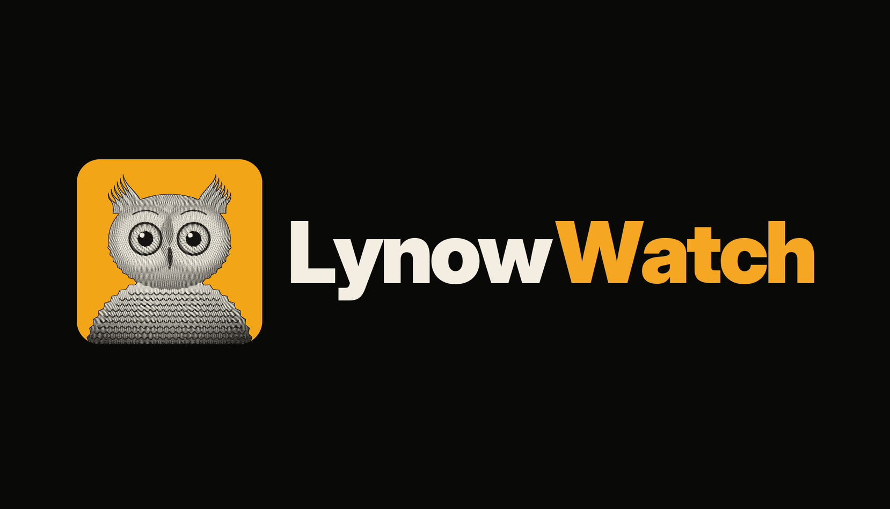

<strong>Desenvolvedor back-end apaixonado por cibersegurança. Construo ferramentas para entender como os sistemas quebram e como protegê-los.</strong>

<a href="#sobre-mim">Sobre</a> &nbsp;&nbsp; <a href="#lince-lab">Lince Lab</a> &nbsp;&nbsp; <a href="#produtos">Produtos</a> &nbsp;&nbsp; <a href="#engenharia">Engenharia</a> &nbsp;&nbsp; <a href="#tecnologias">Tecnologias</a> &nbsp;&nbsp; <a href="#proximos">Próximos passos</a>

Sou **Arthur Mendes Entsev**, desenvolvedor back-end na **Flash Engenharia** e estudante de **Análise e Desenvolvimento de Sistemas na Fatec Sorocaba**.

No dia a dia eu faço APIs, automações e ferramentas internas. Foi justamente construindo sistema que eu me apaixonei por segurança. Toda vez que eu escrevia um login ou uma consulta ao banco, vinha a pergunta "e se alguém tentar quebrar isso?". Hoje eu estudo cibersegurança todo dia e transformo cada assunto em uma ferramenta funcionando, com testes e documentação.

<table>
<tr><th align="left">O que eu já faço</th><th align="left">Para onde estou indo</th></tr>
<tr><td>APIs REST em Java, Python e C#, automação e bancos de dados</td><td>Blue team, análise de logs, detecção e resposta a incidentes</td></tr>
<tr><td>Código com teste automatizado e CI no GitHub Actions</td><td>Segurança de aplicações (AppSec) e desenvolvimento seguro</td></tr>
<tr><td>Ferramentas desktop e web que resolvem problema real</td><td>Redes, criptografia aplicada e hardening</td></tr>
</table>

O **Lince Lab** é a minha coleção de projetos de segurança. Cada um nasceu de uma aula ou sala que eu estudei, e o README de cada projeto tem o link do material que segui, o que eu aprendi e o que ainda quero melhorar. Todos têm testes rodando no GitHub Actions.

<table>
<tr>
<td width="50%" valign="top">
<strong>Lince Portscan</strong> Scanner de portas TCP com threads, banner grabbing e saída em JSON.
Python · socket · threading</td>
<td width="50%" valign="top">
<strong>Password Auditor</strong> Força real de senha e consulta ao Have I Been Pwned com k-anonymity.
Python · HIBP · NIST 800-63B</td>
</tr>
<tr>
<td width="50%" valign="top">
<strong>Hash Lab</strong> Identifica hashes, confere integridade de arquivos e mostra como guardar senha com scrypt.
Python · hashlib · scrypt</td>
<td width="50%" valign="top">
<strong>SSH Brute Detector</strong> Lê o auth.log e detecta força bruta, spraying e login suspeito.
Python · regex · MITRE ATT&CK</td>
</tr>
<tr>
<td width="50%" valign="top">
<strong>FIM PowerShell</strong> Monitor de integridade de arquivos com baseline SHA-256 e alertas em tempo real.
PowerShell · Pester · Windows</td>
<td width="50%" valign="top">
<strong>Phishing Analyzer</strong> Analisa .eml e pontua SPF, DKIM, DMARC, links disfarçados e anexos perigosos.
Python · email · MIME</td>
</tr>
<tr>
<td width="50%" valign="top">
<strong>Security Headers Scanner</strong> Nota de A+ a F para os cabeçalhos HTTP de segurança de um site.
Python · HTTP · OWASP</td>
<td width="50%" valign="top">
<strong>Network Sentinel</strong> Mini IDS que detecta port scan, ARP spoofing e ICMP flood em pcap ou ao vivo.
Python · Scapy · IDS</td>
</tr>
<tr>
<td width="50%" valign="top">
<strong>Cofre de Senhas</strong> Gerenciador de senhas no terminal com scrypt e criptografia autenticada.
Python · cryptography · Fernet</td>
<td width="50%" valign="top">
<strong>JWT Inspector</strong> Decodifica tokens JWT e audita validade, claims, algoritmo e dados expostos.
Python · HMAC · RFC 7519</td>
</tr>
<tr>
<td width="50%" valign="top">
<strong>Subdomain Recon</strong> Inventário passivo de subdomínios pelos logs de Certificate Transparency.
Python · DNS · crt.sh</td>
<td width="50%" valign="top">
<strong>Cifras Clássicas</strong> César, Vigenère e XOR, e a análise de frequência que quebra cada uma.
Python · criptoanálise</td>
</tr>
<tr>
<td width="50%" valign="top">
<strong>Secure Flask Lab</strong> App web com defesas contra SQLi, XSS, IDOR e CSRF, cada uma provada por teste.
Python · Flask · OWASP Top 10</td>
<td width="50%" valign="top">
<strong>Trilha de estudo do Lince Lab</strong>

Redes e varredura &nbsp;&nbsp;<code>01</code> <code>08</code> <code>11</code> 
Detecção e resposta &nbsp;&nbsp;<code>04</code> <code>05</code> <code>06</code> 
Segurança web &nbsp;&nbsp;<code>07</code> <code>10</code> <code>13</code> 
Criptografia e senhas &nbsp;&nbsp;<code>02</code> <code>03</code> <code>09</code> <code>12</code>

Os números são os mesmos da faixa do Lince Lab acima</td>
</tr>
</table>

Ferramentas com identidade própria, documentação e um problema concreto para resolver.

<table>
<tr>
<td width="50%" valign="top">
<strong>LynowCut</strong> Compressão local de imagens, PDFs, documentos, vídeos e áudio, com meta de tamanho.
Python · PySide6 · Pillow · FFmpeg</td>
<td width="50%" valign="top">
<strong>LynowMic</strong> O celular Android como microfone do Windows pela rede local, com pareamento por QR Code e TLS.
C# · WPF · Kotlin · TLS</td>
</tr>
<tr>
<td width="50%" valign="top">
<strong>LynowCatch</strong> Central local para baixar e converter mídia em vídeo, áudio e GIF, com fila e recorte.
Python · yt-dlp · FFmpeg · JavaScript</td>
<td width="50%" valign="top">
<strong>LynowBOM</strong> Da planilha de engenharia ao orçamento, com lista de materiais multinível e formação de preço.
Java · Spring Boot · MySQL · Apache POI</td>
</tr>
<tr>
<td width="50%" valign="top">
<strong>LynowWatch</strong> Serviço do Windows que monitora pastas e organiza, copia ou compacta arquivos por regras.
C# · .NET 8 · Worker Service · xUnit</td>
<td width="50%" valign="top">
<strong>LynowWorlds</strong> Central do Worlds 2026 de League of Legends em português, com séries, drafts e recordes.
JavaScript · Node.js · Vercel</td>
</tr>
</table>

<table>
<tr>
<td width="33%" valign="top">
<strong>Taskflow API</strong> API REST com FastAPI, JWT, SQLite e Docker sem root.
</td>
<td width="33%" valign="top">
<strong>Subnet Calc</strong> Calculadora de sub-redes IPv4 com visão em binário.
</td>
<td width="33%" valign="top">
<strong>Pulso Uptime</strong> Monitor de disponibilidade com página de status no GitHub Actions.
</td>
</tr>
</table>

| Projeto | O que você encontra | Stack |
|---|---|---|
| [Product Manager](https://github.com/arthurlynow098/spring-boot-product-manager) | API REST e painel web de gestão de produtos, herança e polimorfismo | Java · Spring Boot |
| [Lynow Corp](https://github.com/arthurlynow098/lynow-corp-platform) | Back-end de plataforma de micro-jobs com modelagem relacional | Java · Spring Data JPA · MySQL |
| [Docker Configurator](https://github.com/arthurlynow098/Docker-product-configurator) | Aplicação web e banco organizados em containers com rede isolada | Docker · PHP · MySQL |
| [Projeto Enquete](https://github.com/arthurlynow098/ProjetoPWEnquete) | Enquetes com autenticação, perfis de acesso e SQL Server | C# · ASP.NET Core · EF Core |
| [SQL Engineering Lab](https://github.com/arthurlynow098/SQL-engineering-lab) | Modelagem, consultas analíticas, filtros e regras de negócio | MySQL |

**Projeto integrador.** O [ANG / O-BRECHÓ](https://github.com/arthurlynow098/ANG) é o sistema de gestão da Associação Nova Geração, feito em equipe na faculdade. Reúne doações, estoque, vendas e caixa, com requisitos, protótipos e testes.

| Área | Ferramentas presentes nos meus projetos |
|---|---|
| **Segurança** | Scapy · cryptography · hashlib · análise de logs · MITRE ATT&CK · OWASP Top 10 |
| **Back-end e APIs** | Java · Spring Boot · Python · FastAPI · Flask · C# · ASP.NET Core · Node.js |
| **Desktop e automação** | Python · PySide6 · PowerShell · WPF · .NET Worker Service |
| **Dados** | MySQL · SQL Server · SQLite · Oracle PL/SQL · JPA · Entity Framework |
| **Infra e qualidade** | Docker · Git · GitHub Actions · pytest · Pester · xUnit |

- **Web e estudos de faculdade.** [TAPWM](https://github.com/arthurlynow098/TAPWM), laboratório de programação web e mobile com DOM, Promises, Node.js e Express
- **Interfaces.** [Front-end do TCC](https://github.com/arthurlynow098/frontEndTCC) e o meu [portfólio](https://github.com/arthurlynow098/portfolio)
- **Jogos.** [FlappyBird Game](https://github.com/arthurlynow098/FlappyBird-Game), jogo de navegador em JavaScript puro

O que estou estudando agora e quero transformar em projeto em seguida

- [ ] Montar um homelab com Wazuh e documentar a detecção dos ataques do Lince Lab
- [ ] Trilha de SOC no TryHackMe e laboratórios da PortSwigger Academy
- [ ] Regras de detecção em Sigma e YARA
- [ ] Hardening de servidor Linux com checklist automatizado

<strong>Estudo, construção e evolução</strong>

<a href="https://arthurentsev.vercel.app/">Portfólio</a> &nbsp;&nbsp; <a href="https://www.linkedin.com/in/entsevarthur/">LinkedIn</a> &nbsp;&nbsp; <a href="mailto:arthurmendes0505@Outlook.com">E-mail</a> &nbsp;&nbsp; <a href="#top">Voltar ao topo</a>

